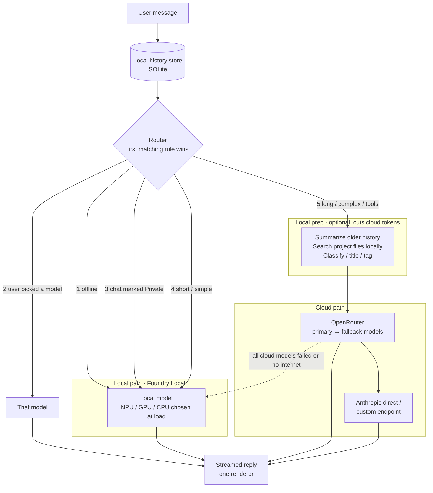

# Crosspoint Chat — Build Plan

A **Windows desktop app** with Claude Desktop / ChatGPT / Gemini feature parity, running on third-party model APIs (OpenRouter, OpenAI-compatible endpoints, Anthropic direct). Single user. All provider keys, connector credentials, MCP server definitions and spend limits come from the **admin portal at admin.docmoates.com**; the app never stores a raw provider key the admin did not hand it.

Decisions (2026-11-03): Windows desktop app (not web), design = carbon copy of Claude Desktop (see `mockup/index.html`), providers OpenRouter + OpenAI-compatible + Anthropic, scope = everything the subscriptions do, keys and connectors managed in admin.docmoates.com, model tags are user-defined.

Superseded: the earlier web/PWA plan (ai.docmoates.com, Cloudflare Access, VPS Compose stack). Android is out of scope for v1; a later companion client could reuse the same admin sync.

---

## 1. Feature inventory (parity target)

| Area | Features |
|---|---|
| Chat core | Streaming, markdown + LaTeX + Mermaid, code blocks with copy/run, edit & resend, regenerate, branch/fork, stop, message search, pin, archive, folders, export (MD/JSON/PDF) |
| Models | Picker populated from OpenRouter catalog + admin-defined custom endpoints + Anthropic + **local models via Foundry Local**; **Auto** default that routes local vs cloud (section 2b); per-chat model; effort/thinking; temperature/system overrides; per-task routing (local or cheap model for titles/summaries); fallback chain on 429 ending at the local model; cost meter per message and per month with local share; **user-defined tags** (name + color, assigned per model, filter the picker) |
| Hybrid local + cloud | Foundry Local runtime (NPU/GPU/CPU), Private toggle per chat/message, router rules, local prep (history summary, local doc search, background jobs, optional try-local-first, draft-then-refine, answer cache), offline mode |
| Sub-chats (topic-aware context) | Local model classifies each request; several topics can stay open at once and are kept in full; an idle topic (no reference for N turns or a set time, no work in progress) is compressed to 1–3 sentences, shown as a divider, auto-saved (searchable, embeddable) and reopened automatically when referenced or on click; the app asks before compressing when context is full |
| Attachments | Images (vision), PDFs, docs/xlsx/pptx, audio, drag-drop, paste, screenshot of a window, "Add from GitHub/Drive" via connectors |
| Tools (built-in) | Web search + fetch with citations, code interpreter (local Python/Node in a sandboxed job object), image generation, TTS, STT, memory read/write |
| Artifacts | HTML/React/SVG/Mermaid preview in a sandboxed webview, documents with inline editing, versions + diff, save to disk, gallery |
| Projects | Instructions, knowledge files (local RAG), project-scoped chats, project-scoped tool/MCP defaults |
| Coding agent | Workspace = any local folder or cloned repo; file tree, editor, embedded terminal, agent loop with read/write/edit/shell/grep; permission prompts (once / always / deny); plan mode; diff review; commit/PR via GitHub connector; subagents |
| MCP | stdio servers launched locally (npx/uvx/exe), Streamable HTTP and SSE remote servers with OAuth; definitions and secrets pushed from admin, plus local user-added servers; per-chat toggles; connector gallery |
| Skills | Skill folders (SKILL.md + scripts) in the Claude Code format, local or git-synced; slash commands; auto-trigger |
| Deep research | Planner → parallel searchers → cited report artifact; progress UI; cancel/resume |
| Computer use | Screenshot + click/type on the user's own desktop (Windows UI Automation + screen capture), with per-app consent and a stop key |
| Memory | Auto-extracted + explicit; list/edit/delete; per-project memory |
| Voice | Push-to-talk and continuous voice mode |
| Scheduled tasks | Cron prompts run by the app while it is running (or by a Windows Task Scheduler entry that wakes it); results land in a chat with a toast |
| Desktop integration | System tray, global hotkey (quick ask window), autostart, Windows notifications, file associations for `.md/.pdf` "open with Crosspoint", share-to-app via Windows share target, auto-update |
| Admin link | Pairing with admin.docmoates.com; pulls providers, keys, connectors, MCP servers, allowed models, spend limits; reports usage back; read-only in app with "Edit in admin" deep links |

## 2. Architecture

```
┌────────────────────────── Crosspoint Chat (Electron, Windows) ──────────────────────────┐
│  Renderer (React)        ◀── IPC/stream ──▶   Main process (Node 22)                     │
│  chat UI, artifacts      │                    • provider adapters (OpenRouter, OpenAI-   │
│  (sandboxed webview),    │                      compatible, Anthropic)                   │
│  settings, workspace     │                    • agent loop + tool registry + permissions │
│                          │                    • MCP client (stdio child procs, HTTP/SSE) │
│                          │                    • local SQLite (chats, projects, memory,   │
│                          │                      embeddings via sqlite-vec)               │
│                          │                    • sandbox runner (job objects / WSL opt.)  │
│                          │                    • scheduler, tray, hotkey, updater         │
│                          │                    • admin sync client                        │
└──────────────────────────┴────────────────────────────┬────────────────────────────────┘
                                                        │ HTTPS (device token)
                                                        ▼
                                             admin.docmoates.com
                              providers · keys · connectors · MCP defs · limits · usage
                                                        │
                                   ┌────────────────────┼────────────────────┐
                                   ▼                    ▼                    ▼
                             OpenRouter        OpenAI-compatible URLs     Anthropic API
```

**Why Electron.** Claude Desktop and ChatGPT Desktop are Electron; the MCP SDK, Vercel AI SDK and the coding-agent tooling are Node; stdio MCP servers are child processes of the main process. Tauri would be lighter but would force a Rust/sidecar bridge for all of that. The mockup's HTML/CSS carries over directly into the React renderer.

**Admin pairing and sync.** First run shows a pairing screen: the user signs in to admin.docmoates.com, admin issues a device token (shown as a code or deep link `crosspoint://pair?token=…`). The app stores the token in Windows Credential Manager (via `keytar`/`safeStorage`). Every 60 s and on demand it calls `GET /api/devices/me/config` and receives:
- `providers[]`: id, kind (openrouter | openai-compatible | anthropic), base URL, **key**, enabled, allowed models, spend limit
- `connectors[]`: GitHub, Google Drive, Calendar… with OAuth tokens or a refresh endpoint
- `mcp_servers[]`: name, transport, command/args or URL, env/secrets, enabled by default
- `tool_providers[]`: web search key, image gen, STT/TTS
- `limits`, `policies` (e.g. computer use allowed, shell allowed)

Keys are held in memory and in `safeStorage`-encrypted local cache so the app works offline until the token is revoked. The app posts usage (`POST /api/devices/me/usage`) per message so admin's spend dashboard stays authoritative. Admin is the only place keys are edited; the app's Providers and Connectors pages are read-only with "Edit in admin" links. Local user-added MCP servers and skills live only on the machine.

**Provider abstraction.** One `ChatProvider` interface: `stream(messages, tools, options) → AsyncIterable<Event>` with events `text`, `thinking`, `tool_call`, `tool_result`, `usage`, `citation`, `notice`, `done`. Adapters: `openai-compat` (OpenRouter + any base URL; Chat Completions, tool calling, vision, `reasoning` passthrough) and `anthropic` (extended thinking, prompt caching, PDF input, server tools, computer-use beta). Model catalog from OpenRouter `/models` hourly, filtered by admin's allowlist; each record carries context, price, capabilities, and the user's tags.

**Agent loop.** Model emits tool calls → main process dispatches to the registry (built-in, MCP, skills) → results appended → repeat until `done` or step cap. Permission policy per tool (auto / ask / deny), "ask" rendered as the permission card in the UI. Same loop drives chat tools, the coding agent and deep research.

**Sandboxing on Windows.** Code interpreter and agent shell commands run as child processes inside a Windows Job Object (CPU/memory/time caps, kill-on-close) in a per-chat working folder, with network off by default via a per-process firewall rule; optional WSL2 or Docker Desktop backend when present for stronger isolation. Artifacts render in a sandboxed `<webview>` with a strict CSP and no Node access.

**Storage.** SQLite (`better-sqlite3`) in `%APPDATA%\Crosspoint\` with `sqlite-vec` for embeddings; attachments and artifacts on disk under the same folder; nightly local backup zip, optional upload to admin or Backblaze.

## 2b. Hybrid local + cloud routing

The app runs small models on the PC through **Foundry Local** (Microsoft's local runtime; it picks the NPU, GPU or CPU variant of a model when the model loads, and exposes an OpenAI-style endpoint) alongside the cloud providers. Because local and cloud both speak the OpenAI format, the chat screen has one renderer and one streaming path.



**Router rules, in order** (evaluated before any model runs, so the decision is near-instant):
1. Device offline → local.
2. User picked a model in the picker → that model. (Picker default is **Auto**.)
3. Chat or message marked **Private** (lock icon in the composer) → local only; nothing leaves the machine, including prep steps.
4. Short or simple request (length, no tools, no attachments, classifier says "chit-chat / lookup") → local.
5. Otherwise → cloud, with local prep first.

**Local prep steps** (each a toggle in Settings › Models › Hybrid routing; defaults in bold):
- **Summarize older history**: local model compresses everything but the last N turns into a short summary before the cloud call.
- **Search project files locally**: local embeddings + sqlite-vec pick the few relevant passages; only those are sent.
- **Local background jobs**: chat titles, tags, language detection, request classification, spell-check never hit the cloud.
- Try local first: local model answers, a confidence check decides whether to escalate to cloud. Off by default; enable once usage data shows which messages the small model handles well.
- Draft locally, refine in cloud: for long outputs the local model drafts, the cloud model edits (fewer output tokens).
- **Cache answers**: identical or near-identical questions reuse the stored reply.

**Sub-chats: topic-aware context (local model, always on).** A chat is a container; each topic inside it is a **sub-chat** with its own context, title and summary. Sub-chats are created automatically by the local model and can also be started by hand with **Branch into sub-chat** on any message; they can be merged or split by hand if the detector guesses wrong. The local model reads every incoming request before routing and keeps the context window focused on the current topic:
1. **Classify the request** against the current topic: continuation, follow-up that needs earlier detail, or new topic. Cheap local call, runs with the router.
2. **On a topic change**, the local model compresses the old topic into a 1–3 sentence summary (what was asked, what was decided, any artifacts or files produced). The chat shows a divider: "Topic changed · summary · Saved as *Part 1: OpenRouter streaming adapter*".
3. **The context sent to any model** from then on is: project instructions + memory + the stack of topic summaries + the messages of the current topic only. Old messages stay in SQLite but are not resent, so cloud cost stops growing with chat length.
4. **Auto-save the old topic** as a referenceable segment (`topic_segments`: conversation id, message range, title, summary, embedding). Segments appear in the sidebar under the chat ("3 topics") and in search. The local model also embeds each summary.
5. **Bring it back when needed.** If a later request references an earlier topic (classifier says "needs earlier detail", or local search over segment summaries scores high), the app pulls that segment's full messages, or just its summary, back into context for that one call and shows "Using Part 1" on the reply. The user can also click "Bring back" on any divider or pin a segment to keep it in context.
6. **Long single topics** still get the rolling summary from the prep step above (last N turns verbatim, older turns compressed).
7. **Several tasks at once: never get in the way.** A topic change does not compress anything by itself; it only marks a new *open* topic. A chat can have several open topics (for example adapter code, an email draft and a quiz) and the user can hop between them; every open topic stays in context in full. A topic is compressed only when it has gone **idle**: not referenced for N turns (default 8) or for a set time (default 2 hours), and never while it has work in progress (an artifact being iterated, a diff under review, an unanswered question). Compression is **reversible**: the full messages are kept, "Reopen" restores them to context in one click, and if the classifier sees a request about a compressed topic it reopens that topic automatically rather than guessing from the summary. If the context window is getting full with many open topics, the app asks ("Pause Part 1 and Part 3?") instead of compressing silently. Rule of thumb implemented in the classifier prompt: when unsure whether a topic is finished, leave it open.
Settings › Models › Hybrid routing: "Keep multiple topics open" (on), "Compress a topic after it is idle for" (8 turns / 2 h), "Never compress work in progress" (on), "Ask before compressing when context is full" (on), sensitivity (conservative / normal / eager), "Keep last N turns verbatim" (6), and a per-chat override "Keep full history".

**Fallback.** Cloud failures retry in two layers: OpenRouter's model fallbacks first (configured per routing rule from admin's allowlist), then the app's own chain (Anthropic direct → custom endpoint), then the local model. The UI shows a `notice` event ("Rate limited on X, trying Y" / "Offline, answered locally").

**Cost visibility.** Each assistant message shows its path (local / cloud via provider) and tokens saved by prep. The sidebar monthly line shows spend and the share of messages handled locally. Usage reports to admin include the path so admin's dashboard can show local vs cloud.

**Tradeoffs to watch.** Prep adds latency before the cloud call starts; a weak local summary or search can drop details; try-local-first answers hard questions twice. Start with summaries, local search and background jobs, which save the most for the least risk.

## 3. Stack

| Layer | Choice | Why |
|---|---|---|
| Shell | Electron 33+, electron-builder (NSIS installer + auto-update), electron-vite | Same shell as Claude/ChatGPT Desktop; MCP + Node ecosystem |
| Renderer | React 19 + TypeScript, Tailwind, shadcn/ui, Zustand, react-markdown + Shiki + KaTeX + Mermaid, CodeMirror 6, xterm.js | Mockup ports directly |
| Main | Node 22, Vercel AI SDK (`ai`, `@ai-sdk/openai-compatible`, `@ai-sdk/anthropic`), `@modelcontextprotocol/sdk`, Zod, Drizzle + better-sqlite3 + sqlite-vec, node-pty | Streaming, tool-call normalization, local DB, terminal |
| Secrets | Electron `safeStorage` (DPAPI) + Credential Manager for the device token | Never plaintext on disk |
| Sandbox | Job Objects via a small native helper; WSL2/Docker optional | Caps without requiring Docker |
| Local models | Foundry Local (`foundry` CLI/SDK, OpenAI-compatible endpoint on localhost); default small model Phi-4-mini or Qwen 2.5 small; local embedding model for RAG | Runs on NPU/GPU/CPU with no code changes; same adapter as cloud |
| Computer use | `@nut-tree/nut-js` or Windows UI Automation via `node-ffi-napi`; screen capture via Electron `desktopCapturer` | Local, consented |
| Updates | electron-updater with releases hosted by admin.docmoates.com or GitHub Releases | One-click updates |
| Tests | Vitest (main), Playwright for Electron (E2E) | |

## 4. Data model (SQLite)

`settings` · `providers` (mirror of admin, with cached keys encrypted; includes the local Foundry provider) · `models` (catalog cache + user tags + local flag/hardware) · `tags` (name, color) · `routing_rules` · `answer_cache` · `history_summaries` (per conversation, covering message range) · `sub_chats` (conversation id, message range, title, 1–3 sentence summary, embedding, state open|paused|pinned, created_by auto|user) · `projects` · `project_files` + `chunks` (vec) · `conversations` (project_id, model, settings, parent_message_id) · `messages` (role, parts JSON, usage, cost) · `attachments` · `artifacts` + `artifact_versions` · `memories` · `mcp_servers` (source: admin | local) · `skills` · `workspaces` (path, branch) · `agent_runs` + `agent_events` · `scheduled_tasks` + `runs` · `usage_outbox` (pending usage reports to admin).

## 5. Phases

### Phase 0 — Foundation (week 1)
- Repo: `apps/desktop` (electron-vite: `main/`, `preload/`, `renderer/`), `packages/providers`, `packages/shared`, `packages/tools`.
- Admin contract: agree the device-pairing flow and the `/api/devices/me/config` + `/usage` schemas with the admin project (JSON schema in `packages/shared/admin-contract.ts`, shared by both repos).
- Pairing screen, token in Credential Manager, config sync, provider adapters, OpenRouter catalog sync.
- **Done when:** installer runs on Windows, pairs with admin, and streams a hello from OpenRouter, a custom endpoint and Anthropic using keys that only exist in admin.

### Phase 1 — Chat parity (weeks 2–3)
- Port the mockup UI to React: sidebar, threads, markdown/code/LaTeX/Mermaid, streaming, stop, edit/regenerate/branch, search, folders, pins, export.
- Model picker with catalog, cost per message, thinking controls, per-task routing, fallback chain, user-defined tags with colors.
- Foundry Local integration: detect/install runtime, download default local model, local group in the picker, Auto routing with rules 1–4, Private toggle, offline mode, routing notice on each reply.
- Composer + menu: uploads, photo/screenshot, add from connectors, tools, connectors, skills.
- Attachments with local text extraction (pdf.js, mammoth, xlsx). Memory v1, custom instructions. Tray, hotkey quick-ask, notifications, auto-update.
- **Done when:** daily-driver replacement for basic ChatGPT/Claude chat.

### Phase 2 — Tools and artifacts (weeks 4–5)
- Tool registry + permission policy. Web search (key from admin), local code interpreter in job objects with file outputs and charts, image gen, TTS/STT.
- Artifacts pane: sandboxed webview, versions, diff, save, gallery.
- Projects with knowledge files and local RAG (sqlite-vec; embeddings via a local model by default).
- Local prep pipeline: history summarization, local doc search, local background jobs, answer cache; tokens-saved counter per message.
- Sub-chats: local request classifier, auto-created sub-chat per topic, Branch into sub-chat on any message, idle-only compression to 1–3 sentences, saved sub-chats in sidebar and search, reopen on reference or click, merge/split by hand, per-chat "keep full history" override. Try-local-first and draft-then-refine behind toggles, off by default.
- Voice mode.
- **Done when:** tool calls stream as cards, artifacts render and version, projects answer from their files.

### Phase 3 — MCP, skills, coding agent (weeks 6–8)
- MCP client: stdio servers as child processes (admin-pushed and local), HTTP/SSE with OAuth; tools/resources/prompts; per-chat toggles; gallery; import from `claude_desktop_config.json`.
- Skills: local folders, git sync, SKILL.md parsing, slash commands, auto-trigger.
- Coding agent: open any local folder, file tree + CodeMirror, node-pty terminal, agent loop, plan mode, permission prompts, diff review, commit/PR via GitHub connector, subagents.
- **Done when:** point it at a local repo, ask for a change, review the diff, open a PR.

### Phase 4 — Deep research, computer use, scheduled tasks (weeks 9–10)
- Deep research pipeline in a worker thread with progress events and a cited report artifact.
- Computer use on the user's desktop with per-app consent, a visible overlay and a panic key.
- Scheduled tasks (in-app cron + optional Task Scheduler wake), toasts.
- Spend view mirrored from admin; limits enforced locally too.
- **Done when:** parity list in section 1 fully checked.

### Phase 5 — Polish
- Shortcuts, palette, themes, accessibility, crash reporting, backups, E2E tests, signed installer (code-signing cert) and SmartScreen reputation.

## 6. Risks and choices to make early

- **Admin contract first.** Pairing flow and config/usage schemas must be agreed with the admin project before Phase 0 ends; both repos import the same `admin-contract.ts`.
- **Key exposure.** Keys live in the main process only; the renderer never sees them. If the device token is revoked, the app wipes its key cache. Decide whether admin proxies provider calls instead of handing out keys (safer, adds latency and makes admin a hard dependency). Recommendation: hand out keys, cache encrypted, revoke via sync.
- **Sandbox strength.** Job Objects cap resources but are not a security boundary against malicious code. Default-deny shell permissions in chat; offer WSL2/Docker backend for the coding agent.
- **Provider feature gaps.** Thinking, caching, PDF input and computer use differ by route; adapters advertise capabilities per model and the UI greys out what a model cannot do.
- **Code signing.** Budget for an EV or OV certificate early; unsigned installers trip SmartScreen.
- **Computer use safety.** Per-app allowlist, no financial sites, overlay + stop key, screenshots never leave the machine except to the model the user picked.

## 7. Repo layout

```
Crosspoint-Chat/
  apps/desktop/
    main/            Electron main: providers, agent loop, MCP, sqlite, sandbox, sync, tray
    preload/         typed IPC bridge
    renderer/        React UI (ported from mockup/)
  packages/providers/ ChatProvider + openai-compat + anthropic adapters
  packages/shared/    zod schemas, admin-contract.ts, tool definitions
  packages/tools/     built-in tools (search, interpreter, image, tts, memory)
  mockup/             static design mockup (source of truth for look and feel)
  docs/               PLAN.md, ADRs
```

## 8. Immediate next steps

1. In the admin chat: add device pairing + `/api/devices/me/config` + `/usage` endpoints, and MCP server / connector definitions as admin-managed objects. Share `admin-contract.ts`.
2. Approve the mockup (v3) as the visual spec.
3. Phase 0: scaffold electron-vite app, pairing, sync, provider adapters, first streamed reply.
