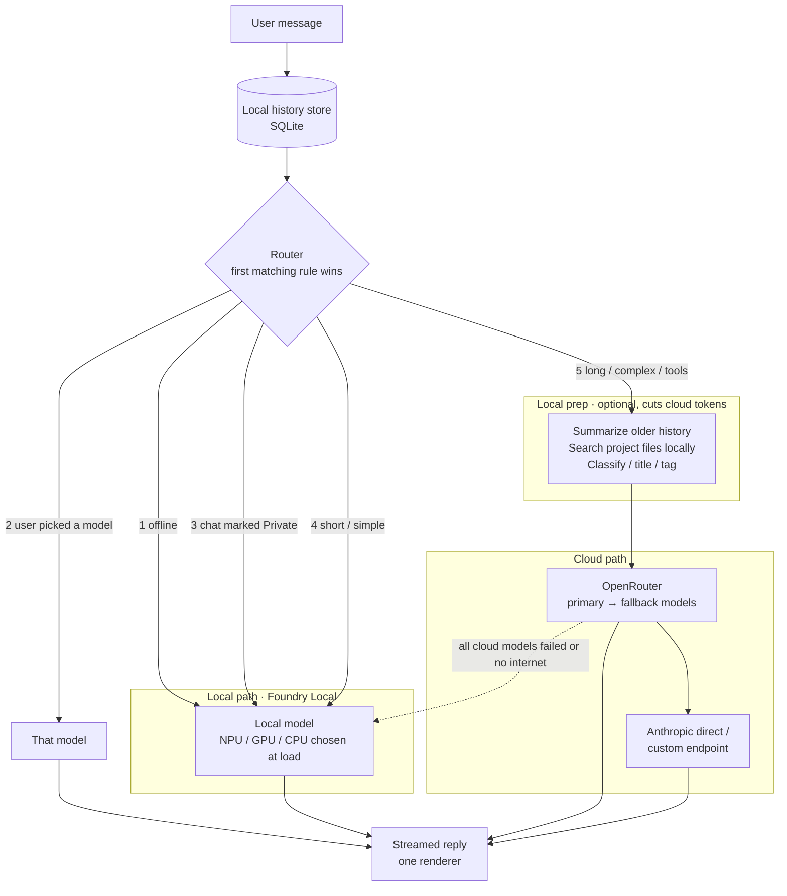

# Crosspoint Chat — Build Plan

A **Windows desktop app** with Claude Desktop / ChatGPT / Gemini feature parity, running on third-party model APIs (OpenRouter, OpenAI-compatible endpoints, Anthropic direct). Single user. All provider keys, connector credentials, MCP server definitions and spend limits come from the **admin portal at admin.docmoates.com**; the app never stores a raw provider key the admin did not hand it.

Decisions (2026-11-03): Windows desktop app (not web), design = carbon copy of Claude Desktop (see `mockup/index.html`), providers OpenRouter + OpenAI-compatible + Anthropic, scope = everything the subscriptions do, keys and connectors managed in admin.docmoates.com, model tags are user-defined.

Superseded: the earlier web/PWA plan (ai.docmoates.com, Cloudflare Access, VPS Compose stack). Android is out of scope for v1; a later companion client could reuse the same admin sync.

---

## 1. Feature inventory (parity target)

| Area | Features |
|---|---|
| Chat core | Streaming, markdown + LaTeX + Mermaid, code blocks with copy/run, edit & resend, regenerate, branch/fork, stop, message search, pin, archive, folders, export (MD/JSON/PDF) |
| Models | Picker populated from OpenRouter catalog + admin-defined custom endpoints + Anthropic + **local models via Foundry Local**; **Auto** default that routes local vs cloud (section 2b); per-chat model; effort/thinking; temperature/system overrides; per-task routing (local or cheap model for titles/summaries); fallback chain on 429 ending at the local model; cost meter per message and per month with local share; **user-defined tags** (name + color, assigned per model, filter the picker) |
| Hybrid local + cloud | Foundry Local runtime (NPU/GPU/CPU), Private toggle per chat/message, router rules, local prep (history summary, local doc search, background jobs, optional try-local-first, draft-then-refine, answer cache), offline mode |
| Sub-chats (topic-aware, background agents, coordinated) | Sub-chats share a coordination board: claims on files/artifacts, messages to each other, shared facts, merge checks between workspace branches, combined needs-you card on a clash. Each sub-chat is its own run loop and keeps working while you are elsewhere (states idle / running / needs you / done; concurrency cap; results summarized locally; sidebar badges and tray count). Local model classifies each request; several topics can stay open at once and are kept in full; an idle topic (no reference for N turns or a set time, no work in progress) is compressed to 1–3 sentences, shown as a divider, auto-saved (searchable, embeddable) and reopened automatically when referenced or on click; the app asks before compressing when context is full |
| Attachments | Images (vision), PDFs, docs/xlsx/pptx, audio, drag-drop, paste, screenshot of a window, "Add from GitHub/Drive" via connectors |
| Tools (built-in) | Web search + fetch with citations, code interpreter (local Python/Node in a sandboxed job object), **local image generation with chat-chosen settings (section 2e)** plus cloud image models, TTS, STT, memory read/write |
| Artifacts | HTML/React/SVG/Mermaid preview in a sandboxed webview, documents with inline editing, versions + diff, save to disk, gallery |
| Projects | Instructions, knowledge files (local RAG), project-scoped chats, project-scoped tool/MCP defaults |
| Coding agent | Workspace = any local folder or cloned repo; file tree, editor, embedded terminal, agent loop with read/write/edit/shell/grep; permission prompts (once / always / deny); plan mode; diff review; commit/PR via GitHub connector; subagents |
| MCP | stdio servers launched locally (npx/uvx/exe), Streamable HTTP and SSE remote servers with OAuth; definitions and secrets pushed from admin, plus local user-added servers; per-chat toggles; connector gallery |
| Skills | Skill folders (SKILL.md + scripts) in the Claude Code format, local or git-synced; slash commands; auto-trigger |
| Deep research | Planner → parallel searchers → cited report artifact; progress UI; cancel/resume |
| Computer use | Screenshot + click/type on the user's own desktop (Windows UI Automation + screen capture), with per-app consent and a stop key |
| Memory | Auto-extracted + explicit; list/edit/delete; per-project memory |
| Voice | Push-to-talk and continuous voice mode |
| Scheduled tasks | Cron prompts run by the app while it is running (or by a Windows Task Scheduler entry that wakes it); results land in a chat with a toast |
| Desktop integration | System tray, global hotkey (quick ask window), autostart, Windows notifications, file associations for `.md/.pdf` "open with Crosspoint", share-to-app via Windows share target, auto-update |
| Admin link | Pairing with admin.docmoates.com; pulls providers, keys, connectors, MCP servers, allowed models, spend limits; reports usage back; read-only in app with "Edit in admin" deep links |

## 2. Architecture

```
┌────────────────────────── Crosspoint Chat (Electron, Windows) ──────────────────────────┐
│  Renderer (React)        ◀── IPC/stream ──▶   Main process (Node 22)                     │
│  chat UI, artifacts      │                    • provider adapters (OpenRouter, OpenAI-   │
│  (sandboxed webview),    │                      compatible, Anthropic)                   │
│  settings, workspace     │                    • agent loop + tool registry + permissions │
│                          │                    • MCP client (stdio child procs, HTTP/SSE) │
│                          │                    • local SQLite (chats, projects, memory,   │
│                          │                      embeddings via sqlite-vec)               │
│                          │                    • sandbox runner (job objects / WSL opt.)  │
│                          │                    • scheduler, tray, hotkey, updater         │
│                          │                    • admin sync client                        │
└──────────────────────────┴────────────────────────────┬────────────────────────────────┘
                                                        │ HTTPS (device token)
                                                        ▼
                                             admin.docmoates.com
                              providers · keys · connectors · MCP defs · limits · usage
                                                        │
                                   ┌────────────────────┼────────────────────┐
                                   ▼                    ▼                    ▼
                             OpenRouter        OpenAI-compatible URLs     Anthropic API
```

**Why Electron.** Claude Desktop and ChatGPT Desktop are Electron; the MCP SDK, Vercel AI SDK and the coding-agent tooling are Node; stdio MCP servers are child processes of the main process. Tauri would be lighter but would force a Rust/sidecar bridge for all of that. The mockup's HTML/CSS carries over directly into the React renderer.

**Admin pairing and sync.** First run shows a pairing screen: the user signs in to admin.docmoates.com, admin issues a device token (shown as a code or deep link `crosspoint://pair?token=…`). The app stores the token in Windows Credential Manager (via `keytar`/`safeStorage`). Every 60 s and on demand it calls `GET /api/devices/me/config` and receives:
- `providers[]`: id, kind (openrouter | openai-compatible | anthropic), base URL, **key**, enabled, allowed models, spend limit
- `connectors[]`: GitHub, Google Drive, Calendar… with OAuth tokens or a refresh endpoint
- `mcp_servers[]`: name, transport, command/args or URL, env/secrets, enabled by default
- `tool_providers[]`: web search key, image gen, STT/TTS
- `limits`, `policies` (e.g. computer use allowed, shell allowed)

Keys are held in memory and in `safeStorage`-encrypted local cache so the app works offline until the token is revoked. The app posts usage (`POST /api/devices/me/usage`) per message so admin's spend dashboard stays authoritative. Admin is the only place keys are edited; the app's Providers and Connectors pages are read-only with "Edit in admin" links. Local user-added MCP servers and skills live only on the machine.

**Provider abstraction.** One `ChatProvider` interface: `stream(messages, tools, options) → AsyncIterable<Event>` with events `text`, `thinking`, `tool_call`, `tool_result`, `usage`, `citation`, `notice`, `done`. Adapters: `openai-compat` (OpenRouter + any base URL; Chat Completions, tool calling, vision, `reasoning` passthrough) and `anthropic` (extended thinking, prompt caching, PDF input, server tools, computer-use beta). Model catalog from OpenRouter `/models` hourly, filtered by admin's allowlist; each record carries context, price, capabilities, and the user's tags.

**Agent loop.** Model emits tool calls → main process dispatches to the registry (built-in, MCP, skills) → results appended → repeat until `done` or step cap. Permission policy per tool (auto / ask / deny), "ask" rendered as the permission card in the UI. Same loop drives chat tools, the coding agent and deep research.

**Sandboxing on Windows.** Code interpreter and agent shell commands run as child processes inside a Windows Job Object (CPU/memory/time caps, kill-on-close) in a per-chat working folder, with network off by default via a per-process firewall rule; optional WSL2 or Docker Desktop backend when present for stronger isolation. Artifacts render in a sandboxed `<webview>` with a strict CSP and no Node access.

**Storage.** SQLite (`better-sqlite3`) in `%APPDATA%\Crosspoint\` with `sqlite-vec` for embeddings; attachments and artifacts on disk under the same folder; nightly local backup zip, optional upload to admin or Backblaze.

## 2b. Hybrid local + cloud routing

The app runs small models on the PC through **Foundry Local** (Microsoft's local runtime; it picks the NPU, GPU or CPU variant of a model when the model loads, and exposes an OpenAI-style endpoint) alongside the cloud providers. Because local and cloud both speak the OpenAI format, the chat screen has one renderer and one streaming path.



**Router rules, in order** (evaluated before any model runs, so the decision is near-instant):
1. Device offline → local.
2. User picked a model in the picker → that model. (Picker default is **Auto**.)
3. Chat or message marked **Private** (lock icon in the composer) → local only; nothing leaves the machine, including prep steps.
4. Short or simple request (length, no tools, no attachments, classifier says "chit-chat / lookup") → local.
5. Otherwise → cloud, with local prep first.

**Local prep steps** (each a toggle in Settings › Models › Hybrid routing; defaults in bold):
- **Summarize older history**: local model compresses everything but the last N turns into a short summary before the cloud call.
- **Search project files locally**: local embeddings + sqlite-vec pick the few relevant passages; only those are sent.
- **Local background jobs**: chat titles, tags, language detection, request classification, spell-check never hit the cloud.
- Try local first: local model answers, a confidence check decides whether to escalate to cloud. Off by default; enable once usage data shows which messages the small model handles well.
- Draft locally, refine in cloud: for long outputs the local model drafts, the cloud model edits (fewer output tokens).
- **Cache answers**: identical or near-identical questions reuse the stored reply.

**Sub-chats: topic-aware context (local model, always on).** A chat is a container; each topic inside it is a **sub-chat** with its own context, title and summary. Sub-chats are created automatically by the local model and can also be started by hand with **Branch into sub-chat** on any message or **New sub-chat** in the sidebar; they can be merged or split by hand if the detector guesses wrong. **Sidebar:** sub-chats are collapsed under their chat by default; the chat row shows a small count badge (with a spinner if one is running, amber if one needs you) and a chevron expands the nested list (open, running, needs you, done, paused) with a state dot per row; clicking one scrolls to it and makes it the active sub-chat for the composer. In the thread, sub-chat dividers, coordination messages and routing notices are one-line collapsed cards until opened, so a busy chat still reads like a plain conversation. Setting: Collapsed (default) / Expanded / Only when active. **Local only:** classification, titles, summaries, embeddings and the idle timer all run on the Foundry Local model, even when the chat itself is routed to the cloud; no sub-chat bookkeeping ever leaves the PC. The local model reads every incoming request before routing and keeps the context window focused on the current topic:
1. **Classify the request** against the current topic: continuation, follow-up that needs earlier detail, or new topic. Cheap local call, runs with the router.
2. **On a topic change**, the local model compresses the old topic into a 1–3 sentence summary (what was asked, what was decided, any artifacts or files produced). The chat shows a divider: "Topic changed · summary · Saved as *Part 1: OpenRouter streaming adapter*".
3. **The context sent to any model** from then on is: project instructions + memory + the stack of topic summaries + the messages of the current topic only. Old messages stay in SQLite but are not resent, so cloud cost stops growing with chat length.
4. **Auto-save the old topic** as a referenceable segment (`topic_segments`: conversation id, message range, title, summary, embedding). Segments appear in the sidebar under the chat ("3 topics") and in search. The local model also embeds each summary.
5. **Bring it back when needed.** If a later request references an earlier topic (classifier says "needs earlier detail", or local search over segment summaries scores high), the app pulls that segment's full messages, or just its summary, back into context for that one call and shows "Using Part 1" on the reply. The user can also click "Bring back" on any divider or pin a segment to keep it in context.
6. **Long single topics** still get the rolling summary from the prep step above (last N turns verbatim, older turns compressed).
7. **Several tasks at once: never get in the way.** A topic change does not compress anything by itself; it only marks a new *open* topic. A chat can have several open topics (for example adapter code, an email draft and a quiz) and the user can hop between them; every open topic stays in context in full. A topic is compressed only when it has gone **idle**: not referenced for N turns (default 8) or for a set time (default 2 hours), and never while it has work in progress (an artifact being iterated, a diff under review, an unanswered question). Compression is **reversible**: the full messages are kept, "Reopen" restores them to context in one click, and if the classifier sees a request about a compressed topic it reopens that topic automatically rather than guessing from the summary. If the context window is getting full with many open topics, the app asks ("Pause Part 1 and Part 3?") instead of compressing silently. Rule of thumb implemented in the classifier prompt: when unsure whether a topic is finished, leave it open.
8. **Sub-chats run as background agents.** Each sub-chat is its own run loop. Send a request in one, switch to another, and the first keeps going: streaming, tool calls, MCP calls, coding-agent steps, deep research. Nothing blocks the composer. Mechanics:
   - Each sub-chat has a queue and a state: `idle`, `running`, `needs you` (permission prompt, question, or a choice), `done` (unread result), `paused`, `failed`. States show in the sidebar as a dot plus a spinner or badge, and in the Windows tray as a count.
   - Concurrency: up to N sub-chats run at once (default 3; local-model jobs count separately so prep never starves). Extra runs queue. Cloud runs across sub-chats share the provider rate limits, so the router staggers them.
   - When a run finishes while you are elsewhere, the local model writes a one-line result ("PR opened", "3 files changed, 1 test failing") that appears under the sub-chat in the sidebar and as a toast; opening the sub-chat marks it read.
   - Permission prompts and questions from a background sub-chat never pop over what you are doing; they flip the sub-chat to `needs you` with a badge, and the prompt waits in that sub-chat (with a short timeout for "always allow" rules set earlier).
   - A background sub-chat can be handed a long task with no further input ("run the suite and fix failures until green, max 20 steps"), with step and cost caps shown in its header; Pause / Stop in the sidebar row.
   - Sub-chats are isolated by default: separate context, separate workspace branch for coding agents, so two of them cannot edit the same files. One can @mention another ("use the summary from Part 1") and the local model copies that sub-chat's summary in.
   - Scheduled tasks (section 1) are just background sub-chats on a timer.
9. **Sub-chats coordinate so they never undo each other.** All sub-chats in a chat share a small **coordination board** kept in SQLite and mediated by the local model:
   - **Claims.** Before a sub-chat edits a file, artifact, project knowledge entry or memory, it records a claim (what, which sub-chat, since when). A second sub-chat that needs the same thing sees the claim and either waits, asks the holder, or works on a copy; it never overwrites silently. Claims expire when the run ends or the user releases them.
   - **Messages between sub-chats.** A sub-chat can ask another a question or hand it a result ("Part 3 → Part 1: I changed the registry signature to `get(model, opts)`; update your call sites"). The message lands in the target's queue; the local model decides whether it is urgent (interrupt the run at the next safe step) or can wait until the run finishes. Every exchange is visible in both threads as a small card so you can see who told whom what.
   - **Shared facts.** Decisions and results a sub-chat produces (a chosen library, a renamed function, a finished artifact) are written to the chat's shared facts list by the local model and injected into every other sub-chat's context on its next step. No sub-chat works from stale assumptions.
   - **Code: branches and merge checks.** Each coding sub-chat works on its own workspace branch. Before any branch is merged or a PR opened, the app rebases it on the others' merged work, runs a conflict check, and if two sub-chats touched the same hunks it opens a merge card (side by side, pick or ask the local model to reconcile) instead of letting one clobber the other. Tests run after the merge, not just before.
   - **Artifacts and documents.** Versioned; a sub-chat editing an artifact another one created adds a version on top rather than replacing, and the diff is shown to both.
   - **Conflict rule.** When the board cannot resolve something (two sub-chats want opposite changes), both flip to `needs you` with one combined card explaining the clash and the options. Nothing is discarded until you choose.
   - **User view.** The sidebar row shows a small lock icon when a sub-chat holds claims; the chat header has a "Coordination" drawer listing claims, pending messages, shared facts and merge status.
Settings: coordination on (always on; only the interrupt policy is adjustable: interrupt for urgent messages / wait until done).
Settings: max concurrent sub-chats (3), notify when done (toast / tray / silent), auto-approve rules carry over to background runs (on).
Settings › Models › Hybrid routing: "Keep multiple topics open" (on), "Compress a topic after it is idle for" (8 turns / 2 h), "Never compress work in progress" (on), "Ask before compressing when context is full" (on), sensitivity (conservative / normal / eager), "Keep last N turns verbatim" (6), and a per-chat override "Keep full history".

**Fallback.** Cloud failures retry in two layers: OpenRouter's model fallbacks first (configured per routing rule from admin's allowlist), then the app's own chain (Anthropic direct → custom endpoint), then the local model. The UI shows a `notice` event ("Rate limited on X, trying Y" / "Offline, answered locally").

**Cost visibility.** Each assistant message shows its path (local / cloud via provider) and tokens saved by prep. The sidebar monthly line shows spend and the share of messages handled locally. Usage reports to admin include the path so admin's dashboard can show local vs cloud.

**Tradeoffs to watch.** Prep adds latency before the cloud call starts; a weak local summary or search can drop details; try-local-first answers hard questions twice. Start with summaries, local search and background jobs, which save the most for the least risk.

## 2b-ii. Web search without a browser or quotas

Search is a tiered provider chain behind one `search(query, intent)` tool; the local model picks the starting tier from intent and the chain falls through on empty results, errors or exhausted quota. Every result set is normalized (title, url, snippet, published, source tier) and cached.

1. **Result cache** (free): same or near-duplicate query in the last 24 h, shared across sub-chats (uses the local embedding to match paraphrases).
2. **Bundled local meta-search** (free, no key, no quota): a SearXNG instance packaged with the app and run as a child process on localhost. It queries several engines (DuckDuckGo, Bing, Brave, Startpage, Wikipedia, GitHub, …) over plain HTTP and merges results. Engines occasionally rate-limit; SearXNG rotates and the chain falls through. This is the default for ordinary "look it up" questions.
3. **Direct sources** (free APIs): Wikipedia, arXiv, Semantic Scholar, GitHub, npm/PyPI, MDN and docs sites, Reddit JSON, RSS, Hacker News. The local classifier routes "what is the API for X" or "paper on Y" straight here, which is faster and more accurate than general search.
4. **Brave Search API** (key from admin; 2,000 free queries/month, then paid): used when tier 2 returns too little, is blocked, or the request needs freshness filters. Tavily or Exa can be configured in admin as alternates. Quota counters are tracked per key in admin; the app stops using a tier at 95 % and says so in the cost line.
5. **Model-native search** (paid per call): OpenRouter `:online`, Anthropic server-side web search, Gemini grounding. Reserved for deep research or an explicit "search thoroughly", because each call costs about a cent and the results cannot be cached as cleanly.

**Fetching pages.** Plain HTTP fetch with a real user agent, then Readability extraction to text (tables and code preserved), 1 h page cache, robots.txt honored, per-site pacing. Only pages that come back as empty JS shells are re-rendered in the app's own hidden Chromium window (Electron already ships one), with scripts allowed but no cookies and a short timeout. No external browser is ever launched. PDFs are fetched and parsed locally.

**Safety and cost.** Every fetched page passes the injection screen and redaction before a cloud model sees it (section 2d). Tiers 1–3 cost nothing; the cost line shows the tier used. The search card in chat is one line ("Searched the web · 3 sources · local meta-search") until opened.

## 2c. Cost controls

- **Prompt caching.** The stable prefix (system prompt, project instructions, enabled skills, memory, sub-chat summaries) is marked cacheable on Anthropic direct and passed through on OpenRouter where the model supports it. The adapter orders the prompt so the stable part comes first and the volatile part (current sub-chat messages, tool results) last. Cache hit rate shows in the cost line.
- **Budgets at four levels.** Admin monthly limit (authoritative) → app daily cap → per-sub-chat cap (default $2 / 20 steps for unattended runs) → per-message warning above a threshold. Hitting any cap pauses the run and flips it to `needs you`; nothing silently continues.
- **Cost preview.** Any unattended or tool-heavy run shows an estimate (planned steps × average tokens × model price) before starting and asks for a click above $0.50. The estimate is refined by the local model from past runs of the same kind.
- **Step routing inside the agent loop.** Trivial steps (read file, grep, list directory, fetch a page, summarize a tool result) go to the local model or Haiku; only "decide and edit" steps go to the main model. The loop labels each step, and the routing table in Settings › Models has a row for "agent helper steps".
- **Shared result cache per chat.** Web searches, page fetches, file reads and embeddings are cached for the chat with a short TTL, so several background sub-chats doing the same lookup pay once. The claim board already tracks what each sub-chat touches.
- **Early stop.** The local model watches the stream; if the answer is complete and the model is padding, or a tool result makes the rest moot, the app stops generation and does not pay for the remainder.
- **Embeddings are always local.** Fixed, not a default.
- **Provider rate pacing.** Background runs are staggered so three sub-chats do not trip a provider's limit and push the fallback chain to a more expensive model.
- **Spend visibility.** Per-message "why did this cost that" (tokens in/out, cache hits, prep savings, path), per-sub-chat totals, daily and monthly views mirrored from admin, and a weekly spend summary from admin by email.

## 2d. Security

- **Untrusted tool output.** Web pages, files, MCP results, terminal output and messages from other sub-chats are data, never instructions. Before any tool result reaches a cloud model, the local model screens it for prompt injection (instructions aimed at the assistant, requests to exfiltrate, hidden text). Suspected injections are stripped from the model input and shown to the user as a quoted warning card; the run pauses if the injection targeted a side effect (send, delete, pay, push).
- **Redaction before anything leaves the PC.** A local pass (regex for keys/tokens/card numbers/SSNs plus the small model) runs on file reads, terminal output, attachments, screenshots for computer use and sub-chat messages. Redacted spans are replaced with placeholders; the user can allow a specific span once.
- **Secrets.** Provider keys and connector tokens live in the main process only; the renderer never sees them. Device token in Windows Credential Manager, short-lived with refresh; admin can revoke a device remotely and sees per-device key usage. On revoke the app wipes its key cache.
- **MCP trust.** Admin-pushed servers are trusted. Locally added servers need explicit approval: the app shows the command or URL, pins a hash of the package or binary, lists the tools and resources it exposes, and runs stdio servers in the sandbox with no network unless the manifest declares it. Tool lists are re-approved when they change.
- **Tool allowlists per sub-chat kind.** Chat: search, fetch, interpreter, image, connectors. Research: search, fetch, interpreter. Code: file, shell, git, plus the chat set. Background runs get the tighter default; shell in background requires a prior "always allow" rule. The allowlist is shown in the sub-chat header and editable per sub-chat.
- **Data at rest.** SQLite encrypted with SQLCipher, key held via DPAPI; the database locks when the Windows session locks. Private sub-chats use a separate store excluded from backups and from admin usage detail. Backups are encrypted, versioned, and restore-tested monthly.
- **Audit log.** Every tool call, permission grant, claim, merge, outbound request (host, bytes, model) and admin sync is logged locally with a hash chain; a daily summary goes to admin. Viewable in Settings › Data › Audit.
- **Computer use guardrails.** Per-app allowlist, visible overlay, panic key, never while the screen is locked, blocked on detected password fields and payment pages, screenshots redacted before leaving the PC, every action logged.
- **Sandbox.** Job Objects with CPU/memory/time caps and network off by default; WSL2 or Docker backend when present. Shell in chat is default-deny.
- **Updates.** Signed installer (OV/EV certificate, budgeted in Phase 0), electron-updater verifies signatures, releases served from admin or GitHub Releases over HTTPS.
- **Network allowlist.** Outbound connections only to configured providers, admin, approved MCP hosts and user-approved fetch targets; everything else is blocked at the app level and logged.

## 2e. Local image generation (in chat, like Draw Things)

- **Runtime.** Local diffusion models run on the PC through an ONNX Runtime (DirectML) backend, which uses the GPU or NPU and falls back to CPU, so no CUDA install is needed. `stable-diffusion.cpp` is the alternative backend for GGUF-quantized models on low-VRAM machines. Both expose one internal `ImageProvider` interface (`generate`, `edit`, `inpaint`, `upscale`, `progress` events) alongside the cloud image models already routed through OpenRouter.
- **Models.** A built-in catalog (SDXL, SD 3.5 Medium, FLUX.1-schnell / dev GGUF, plus a fast upscaler and an inpaint model) with one-click download into `%APPDATA%\Crosspoint\models\image`, a VRAM check before download, and user-imported `.safetensors` / `.gguf` / LoRA files. The first run picks a default model that fits the hardware (FLUX-schnell GGUF at 8 GB VRAM, SDXL-Turbo below that, SD 1.5 on CPU).
- **Started from the + menu.** "Generate image" in the composer's + menu switches the composer into image mode (a chip shows the image model in use); the user types the prompt as they want it. Typing an obvious image request in normal mode also offers a one-tap "Generate as image" chip, but never silently converts the message.
- **The prompt is the user's; the chat model sets everything else.** The prompt is sent exactly as typed. The chat model (local Phi-4 mini by default, or the cloud model if the chat is routed there) fills in the negative prompt, model choice from the installed list, size and aspect, steps, guidance, sampler, seed, number of images, and whether an uploaded image is a reference (img2img / inpaint / style). It may list optional additions ("add: golden hour, 35mm") as a separate suggestion the user can apply with one tap; it never rewrites the prompt on its own. The flow is **prompt → chat model proposes settings → user approves → generate**. Nothing runs until the user clicks Generate on the proposal card (a setting, on by default, can skip approval for a chosen model). On the card every value is editable, and the **model picker lists every model tagged `images`** in Settings › Models, local and cloud, grouped (On this PC / Cloud) with price and speed, so the user can switch a local proposal to a cloud model or back in one click. After generation the same card stays above the image as "Settings used" and "Regenerate" reruns with edits. Users never have to know what a sampler is, but can change it.
- **In-chat results.** Images stream progressively (preview every few steps), then show with Regenerate, Variations, Edit (mask + instruction), Upscale, Use as reference, Save, Copy, and Open in Artifacts. Images are artifacts with versions, so edits stack and can be compared.
- **Routing.** Image requests go local by default; cloud image models are used only if the user picks one, the local model cannot do the task (e.g. text rendering quality), or the Private toggle is off and the user allows cloud images. Cost line shows $0.00 local and the time taken.
- **Learning the user's taste.** Thumbs up/down and "more like this" feed a small local preference note (style words, preferred model, sizes) that the chat model reads when planning. Stored in memory, editable.
- **What each model actually receives.** The settings card is one shape; the image adapter maps it per model from a capability table. Local SD/SDXL/FLUX get everything as native parameters (negative prompt, steps, guidance, sampler, seed, size). Cloud models vary: FLUX Pro and SD 3.5 via OpenRouter accept negative prompt, seed, guidance and size; GPT-image and Gemini image models have no negative prompt or sampler, so the adapter folds the negative words into the prompt as an "avoid: …" clause and sends only size and count. The card greys out any field the chosen model ignores and says so ("GPT-image: negative folded into prompt, steps and sampler not used"), so switching a proposal from local to cloud never silently drops a setting.
- **Tags drive the image model list.** Local models get user tags exactly like cloud models (Settings › Models › Tags per model lists Foundry Local chat models and local image models alongside OpenRouter and Anthropic ones). The image picker shows only models tagged `images`; the chat picker filter works the same way for any tag. Installing a local image model tags it `images` and `local` automatically; the user can change that.
- **Settings › Models › Image models.** Installed models with hardware they run on, default model, download manager, VRAM, LoRA folder, output folder, safety filter toggle (on by default), "let the chat model choose settings" (on), "ask me to approve before generating" (on), and "suggest prompt additions" (on, suggestions only).

## 2f. Simple after setup

The goal is that after pairing, a normal day needs no settings at all. Rules the build follows:
- **One installer, one pairing.** Install, sign in to admin once, done. Keys, connectors, MCP servers, allowed models, limits and the default local model arrive from admin or are picked for the hardware.
- **Auto is the default everywhere.** Model = Auto, image model = best fit, routing, caching, prep, sub-chats, coordination and security screening are all on with sensible defaults. Settings exist to override, never to enable.
- **Self-maintaining.** Foundry Local and image runtimes install and update themselves; model catalogs refresh in the background; the app auto-updates silently on close; backups run nightly; the audit log and caches prune themselves.
- **Self-healing.** If a provider fails, the fallback chain handles it and a quiet notice says so. If the local model is missing or the GPU driver changed, the app re-selects a model that works and tells you once. If admin is unreachable, cached config keeps working until the token expires.
- **Nothing nags.** One toast per finished background run, one combined card per clash, one notice per fallback. Everything else goes to the sidebar states and the audit log.
- **A single "Doctor" page** (Settings › General › Health) shows provider status, local runtime status, GPU/NPU, disk used by models, last backup, last sync, and a "Fix" button next to anything red.

## 2g. Other features worth adding

- **Quick ask** global hotkey window (already listed) also accepts a screenshot of the active window and "explain / fix / reply" one-click actions.
- **Read-aloud and dictation** on every message (local TTS/STT where possible).
- **Message templates and snippets** (`/` commands beyond skills), prompt library synced from admin.
- **Export a sub-chat** as Markdown, PDF or a shareable HTML artifact.
- **Clipboard watcher** (opt-in): copy a URL or error text and the quick-ask window offers to act on it.
- **Per-project tool defaults and MCP toggles**, already in Projects; add per-project image style.
- **Canvas / whiteboard artifact** for diagrams, editable with the model.
- **Model comparison**: run one prompt against two models side by side, local vs cloud included.
- **Offline mode indicator** and a queue: messages sent while offline run locally or wait for cloud.
- **Accessibility**: full keyboard navigation, screen-reader labels, high-contrast theme, reduced motion.

## 3. Stack

| Layer | Choice | Why |
|---|---|---|
| Shell | Electron 33+, electron-builder (NSIS installer + auto-update), electron-vite | Same shell as Claude/ChatGPT Desktop; MCP + Node ecosystem |
| Renderer | React 19 + TypeScript, Tailwind, shadcn/ui, Zustand, react-markdown + Shiki + KaTeX + Mermaid, CodeMirror 6, xterm.js | Mockup ports directly |
| Main | Node 22, Vercel AI SDK (`ai`, `@ai-sdk/openai-compatible`, `@ai-sdk/anthropic`), `@modelcontextprotocol/sdk`, Zod, Drizzle + better-sqlite3 + sqlite-vec, node-pty | Streaming, tool-call normalization, local DB, terminal |
| Secrets | Electron `safeStorage` (DPAPI) + Credential Manager for the device token | Never plaintext on disk |
| Sandbox | Job Objects via a small native helper; WSL2/Docker optional | Caps without requiring Docker |
| Local models | Foundry Local (`foundry` CLI/SDK, OpenAI-compatible endpoint on localhost); default small model Phi-4-mini or Qwen 2.5 small; local embedding model for RAG | Runs on NPU/GPU/CPU with no code changes; same adapter as cloud |
| Local images | ONNX Runtime DirectML backend (SDXL, SD 3.5, FLUX) and stable-diffusion.cpp for GGUF; built-in model catalog + downloader; `ImageProvider` interface shared with cloud image models | GPU/NPU/CPU without CUDA; chat model plans the settings |
| Computer use | `@nut-tree/nut-js` or Windows UI Automation via `node-ffi-napi`; screen capture via Electron `desktopCapturer` | Local, consented |
| Updates | electron-updater with releases hosted by admin.docmoates.com or GitHub Releases | One-click updates |
| Tests | Vitest (main), Playwright for Electron (E2E) | |

## 4. Data model (SQLite)

`settings` · `providers` (mirror of admin, with cached keys encrypted; includes the local Foundry provider) · `models` (catalog cache + user tags + local flag/hardware) · `tags` (name, color) · `routing_rules` · `answer_cache` · `history_summaries` (per conversation, covering message range) · `sub_chats` (conversation id, message range, title, 1–3 sentence summary, embedding, state open|paused|pinned, run_state idle|running|needs_you|done|failed, unread, step_cap, cost_cap, created_by auto|user) · `claims` (sub_chat id, resource, since) · `sub_chat_messages` (from, to, body, urgency, read) · `shared_facts` (conversation id, fact, source sub_chat) · `projects` · `project_files` + `chunks` (vec) · `conversations` (project_id, model, settings, parent_message_id) · `messages` (role, parts JSON, usage, cost) · `attachments` · `artifacts` + `artifact_versions` · `memories` · `mcp_servers` (source: admin | local) · `skills` · `workspaces` (path, branch) · `agent_runs` + `agent_events` · `scheduled_tasks` + `runs` · `usage_outbox` (pending usage reports to admin).

## 5. Phases

### Phase 0 — Foundation (week 1)
- Repo: `apps/desktop` (electron-vite: `main/`, `preload/`, `renderer/`), `packages/providers`, `packages/shared`, `packages/tools`.
- Admin contract: agree the device-pairing flow and the `/api/devices/me/config` + `/usage` schemas with the admin project (JSON schema in `packages/shared/admin-contract.ts`, shared by both repos).
- Pairing screen, short-lived device token in Credential Manager with refresh and remote revoke, config sync, provider adapters, OpenRouter catalog sync, SQLCipher database, audit log skeleton, code-signing certificate ordered.
- **Done when:** installer runs on Windows, pairs with admin, and streams a hello from OpenRouter, a custom endpoint and Anthropic using keys that only exist in admin.

### Phase 1 — Chat parity (weeks 2–3)
- Port the mockup UI to React: sidebar, threads, markdown/code/LaTeX/Mermaid, streaming, stop, edit/regenerate/branch, search, folders, pins, export.
- Model picker with catalog, cost per message, thinking controls, per-task routing, fallback chain, user-defined tags with colors.
- Foundry Local integration: detect/install runtime, download default local model, local group in the picker, Auto routing with rules 1–4, Private toggle, offline mode, routing notice on each reply.
- Composer + menu: uploads, photo/screenshot, add from connectors, tools, connectors, skills.
- Attachments with local text extraction (pdf.js, mammoth, xlsx). Memory v1, custom instructions. Tray, hotkey quick-ask, notifications, auto-update.
- **Done when:** daily-driver replacement for basic ChatGPT/Claude chat.

### Phase 2 — Tools and artifacts (weeks 4–5)
- Tool registry + permission policy + per-kind allowlists; injection screening and redaction pass on all tool output; shared result cache; prompt caching; budgets and cost preview.
- Local image generation: runtime install, model catalog and downloader, hardware-fit default, chat-planned settings card, progressive preview, variations/edit/upscale, images as artifacts; cloud image models as fallback. Web search (key from admin), local code interpreter in job objects with file outputs and charts, image gen, TTS/STT.
- Artifacts pane: sandboxed webview, versions, diff, save, gallery.
- Projects with knowledge files and local RAG (sqlite-vec; embeddings via a local model by default).
- Local prep pipeline: history summarization, local doc search, local background jobs, answer cache; tokens-saved counter per message.
- Sub-chats: background run loop per sub-chat with states, concurrency cap, badges, toasts and tray count; coordination board (claims, messages, shared facts, merge checks, clash card); local request classifier, auto-created sub-chat per topic, Branch into sub-chat on any message, idle-only compression to 1–3 sentences, saved sub-chats in sidebar and search, reopen on reference or click, merge/split by hand, per-chat "keep full history" override. Try-local-first and draft-then-refine behind toggles, off by default.
- Voice mode.
- **Done when:** tool calls stream as cards, artifacts render and version, projects answer from their files.

### Phase 3 — MCP, skills, coding agent (weeks 6–8)
- MCP client: stdio servers as child processes (admin-pushed and local, local ones approved with pinned hash and tool list), HTTP/SSE with OAuth; tools/resources/prompts; per-chat toggles; gallery; import from `claude_desktop_config.json`.
- Skills: local folders, git sync, SKILL.md parsing, slash commands, auto-trigger.
- Coding agent: open any local folder, file tree + CodeMirror, node-pty terminal, agent loop, plan mode, permission prompts, diff review, commit/PR via GitHub connector, subagents.
- **Done when:** point it at a local repo, ask for a change, review the diff, open a PR.

### Phase 4 — Deep research, computer use, scheduled tasks (weeks 9–10)
- Deep research pipeline in a worker thread with progress events and a cited report artifact.
- Computer use on the user's desktop with per-app consent, a visible overlay and a panic key.
- Scheduled tasks (in-app cron + optional Task Scheduler wake), toasts.
- Spend view mirrored from admin; limits enforced locally too.
- **Done when:** parity list in section 1 fully checked.

### Phase 5 — Polish
- Simplicity pass (section 2f): Doctor/Health page, self-healing checks, silent updates, nag audit.
- Shortcuts, palette, themes, accessibility, crash reporting, encrypted versioned backups with restore test, network allowlist, E2E tests, SmartScreen reputation.

## 6. Risks and choices to make early

- **Admin contract first.** Pairing flow and config/usage schemas must be agreed with the admin project before Phase 0 ends; both repos import the same `admin-contract.ts`.
- **Key exposure.** Keys live in the main process only; the renderer never sees them. If the device token is revoked, the app wipes its key cache. Decide whether admin proxies provider calls instead of handing out keys (safer, adds latency and makes admin a hard dependency). Recommendation: hand out keys, cache encrypted, revoke via sync.
- **Sandbox strength.** Job Objects cap resources but are not a security boundary against malicious code. Default-deny shell permissions in chat; offer WSL2/Docker backend for the coding agent.
- **Provider feature gaps.** Thinking, caching, PDF input and computer use differ by route; adapters advertise capabilities per model and the UI greys out what a model cannot do.
- **Code signing.** Budget for an EV or OV certificate in Phase 0; unsigned installers trip SmartScreen and auto-update cannot verify.
- **Computer use safety.** Per-app allowlist, no financial sites, overlay + stop key, screenshots never leave the machine except to the model the user picked.

## 7. Repo layout

```
Crosspoint-Chat/
  apps/desktop/
    main/            Electron main: providers, agent loop, MCP, sqlite, sandbox, sync, tray
    preload/         typed IPC bridge
    renderer/        React UI (ported from mockup/)
  packages/providers/ ChatProvider + openai-compat + anthropic adapters
  packages/shared/    zod schemas, admin-contract.ts, tool definitions
  packages/tools/     built-in tools (search, interpreter, image, tts, memory)
  mockup/             static design mockup (source of truth for look and feel)
  docs/               PLAN.md, ADRs
```

## 8. Immediate next steps

1. In the admin chat: add device pairing + `/api/devices/me/config` + `/usage` endpoints, and MCP server / connector definitions as admin-managed objects. Share `admin-contract.ts`.
2. Approve the mockup (v3) as the visual spec.
3. Phase 0: scaffold electron-vite app, pairing, sync, provider adapters, first streamed reply.
